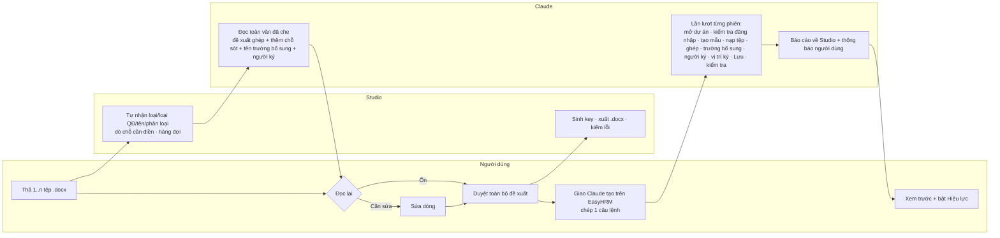

# EasyHRM Template Studio v2 — Phân tích nghiệp vụ "tự động hoá tối đa"

> **Đã có thay đổi:** G4, FR-07, FR-09, FR-11, FR-12, BR-03 được thay thế một phần bởi [`cr/CR-2026-003`](cr/CR-2026-003-tu-danh-gia-giao-claude-kho-tep.md).

Người lập: BA (chung) + BA-HRM · Ngày: 19/11/2026 · Căn cứ hành vi EasyHRM: tri-thuc-easyhrm v2.5.39 (trang `hop-dong-loai-hop-dong-mau-nguoi-ky`, `thiet-lap-quyet-dinh`).

Mục tiêu: người dùng **chỉ đọc lại, duyệt (sửa nếu cần) rồi giao cho Claude**. Mọi việc còn lại — phân tích mẫu, đặt tên, chọn loại, sinh key, tạo trường bổ sung, mở EasyHRM, nạp tệp, ghép trường, người ký, vị trí ký, Lưu, kiểm tra, báo cáo — do Studio + Claude làm.

---

## 1. Hiện trạng và khoảng trống (gap analysis)

| # | Quy trình | Hiện trạng (v1) | Mong muốn (v2) | Khoảng trống | Giải pháp | Ưu tiên |
|---|---|---|---|---|---|---|
| G1 | Đăng nhập EasyHRM | Claude điền MST + tài khoản, người dùng gõ mật khẩu / bấm Đăng nhập mỗi lần | Claude tự đăng nhập | Claude không được gõ mật khẩu (giới hạn an toàn cố định, không tắt được) | Dùng **phiên đăng nhập đã lưu** trong trình duyệt của Claude: đăng nhập 1 lần, các lần sau Claude kiểm tra "đã vào trang chủ" và làm tiếp, không hỏi. Chỉ khi hết phiên mới nhờ người dùng 1 cú bấm. Studio **không lưu mật khẩu** (xem BR-01) | Must |
| G2 | Phân tích mẫu | Chỉ dò theo regex (dấu …, ___, ngày, số tiền…). Mẫu không có "…" → gần như không dò ra. Ngày "ngày … tháng … năm …" bị chẻ 3 chỗ | AI đọc **toàn văn** như BA-HRM, tìm đủ mọi chỗ biến đổi | Phiếu việc chỉ gửi các candidate đã dò, AI không thấy phần còn lại | Phiếu việc gửi **toàn văn đã che dữ liệu cá nhân** + AI được **thêm chỗ sót** (`add_candidates`) + bộ quy tắc phân tích HRM (mục 4) + dò ngày trống thành 1 chỗ | Must |
| G3 | Popup Thêm dự án | Gõ 1 ký tự là mất focus | Gõ bình thường | Lỗi `Modal`: mỗi lần render lại chạy lệnh focus, nhảy về nút ✕ | Sửa (mục 6) | Must |
| G4 | Key không có trường EasyHRM | Người dùng tự chọn "Trường giá trị bổ sung", tự đặt tên | AI tự sinh trường bổ sung, Claude tự tạo trên EasyHRM | Gap T1/T2/T3 chỉ được ghi nhận | Gap T1–T3 **tự thành trường bổ sung** (tên do AI đặt). Khi lên EasyHRM mà tên trường không có trong danh sách "Trường lấy giá trị" → Claude tự tạo trường bổ sung và ghép | Must |
| G5 | Loại văn bản / loại QĐ / tên mẫu / phân loại HĐ | Người dùng chọn tay trước khi tải | Tự nhận theo nội dung tệp | — | Studio tự nhận theo tiêu đề + tên tệp; AI kiểm và sửa qua `doc_meta`; người dùng chỉ xem | Must |
| G6 | Xem trước | Văn bản thuần, mất định dạng | Giống Word | — | Dựng bằng `docx-preview` từ chính tệp .docx (giữ bảng, căn lề, in đậm) | Should |
| G7 | Tạo trên EasyHRM | Người dùng tải .docx từ Studio rồi tự chọn tệp; Claude hỏi trước khi Lưu | Claude tự nạp tệp, làm tới khi Lưu thành công | Studio và EasyHRM khác domain, không chia sẻ tệp | Studio có API trả tệp đã chèn key; Claude nạp thẳng vào ô "Chọn tệp tin mẫu" trong trang EasyHRM. Câu lệnh giao việc **chứa sẵn sự đồng ý Lưu** nên Claude không hỏi lại | Must |
| G8 | Người ký + vị trí ký (hợp đồng) | Claude hỏi người dùng | AI tự phân tích và làm | — | Studio/AI đọc khối chữ ký cuối văn bản → chức danh/tên người ký phía công ty + chữ mốc; Claude chọn người ký khớp trong danh sách, kéo ô tên tới chữ mốc | Must |
| G9 | Tệp đã chèn key sẵn | Không hỗ trợ (dò ra rồi thay lại) | Nạp vào để Claude lên EasyHRM | — | Chế độ **"Tệp đã có key"**: giữ nguyên key trong tệp, chỉ ghép trường | Must |
| G10 | Nhiều tệp | Mỗi lần 1 tệp | Nạp nhiều, xử lý theo thứ tự | — | Tải nhiều tệp một lần → **hàng đợi** (thứ tự = thứ tự tải); Claude làm lần lượt | Must |

## 2. Vai trò

| Vai trò | Làm gì |
|---|---|
| Người dùng (BA/triển khai) | Khai báo dự án 1 lần; thả tệp; đọc lại, sửa nếu cần, bấm **Duyệt**; dán **1 câu lệnh** giao cho Claude; xem trước mẫu trên EasyHRM và bật Hiệu lực |
| Studio (GitHub Pages) | Đọc .docx, tự nhận loại/tên, dò chỗ cần điền, che dữ liệu cá nhân, phiếu việc cho AI, sinh key, xuất .docx, hàng đợi, nhật ký |
| Claude (skill v2) | Phân tích như BA-HRM; điền đề xuất; tạo mẫu trên EasyHRM từ đầu tới khi Lưu thành công; báo cáo |

## 3. Luồng mới

Hai câu lệnh duy nhất người dùng dán vào Claude (Studio chép sẵn):
1. **Phân tích**: "Dùng skill easyhrm-template-studio. Phân tích các phiên chờ AI tại `<link Studio>`."
2. **Tạo trên EasyHRM**: "Dùng skill easyhrm-template-studio. Tôi đã duyệt và đồng ý cho Claude tạo và **bấm Lưu** các mẫu trong hàng đợi tại `<link Studio>` (phiên: s_…, s_…)." — đây là sự đồng ý rõ ràng của người dùng trong chat, nên Claude không hỏi lại trước Lưu.

### Trạng thái phiên (không đổi tên, thêm cờ "đã giao")
`Nháp → Chờ AI → Chờ duyệt → Đã duyệt → Đang tạo trên HRM → Đã tạo, chờ bật → Hoàn tất` (+ `Dừng giữa chừng`).
Cờ mới `handedToHrmAt`: phiên Đã duyệt **và** đã giao → nằm trong hàng đợi của Claude, xếp theo `queueOrder`.

## 4. Phân tích mẫu như BA-HRM (ghi vào skill `references/phan-tich-mau-hrm.md`)

Nguyên tắc: **đọc toàn văn trước, rồi mới quyết từng chỗ**. Một chỗ là tham số khi giá trị đổi theo **nhân viên / lần lập văn bản**; là nội dung cố định khi giống nhau ở mọi văn bản cùng mẫu.

| Vùng văn bản | Thường là tham số | Thường cố định (Bỏ) |
|---|---|---|
| Đầu văn bản | Số văn bản (`Số: …/QĐ-…`), địa danh + ngày lập ("…, ngày … tháng … năm …"), tên đơn vị cấp phòng nếu mẫu dùng chung nhiều đơn vị | Quốc hiệu, tiêu ngữ, tên cơ quan chủ quản cố định |
| Căn cứ | — | Toàn bộ "Căn cứ Luật/Nghị định/Quyết định số … ngày …" (văn bản pháp lý không đổi theo nhân viên). Ngoại lệ: "Căn cứ đơn/đề nghị của ông/bà …", "Căn cứ hợp đồng số … ngày …" → tham số |
| Thân | Họ tên, giới tính (Ông/Bà), ngày sinh, mã NV, CCCD, chức danh/chức vụ cũ–mới, phòng ban/khoa cũ–mới, ngày hiệu lực, thời hạn, mức lương, hệ số, phụ cấp, lý do, địa điểm làm việc | Điều khoản quyền/nghĩa vụ chung, "thời gian giữ chức vụ là 05 năm" nếu quy định cố định (hỏi qua T4 khi không chắc) |
| Cuối | Người ký, chức danh người ký, "Nơi nhận: ông/bà …" | "Nơi nhận: Như Điều 3; Lưu: VT, TCCB" |

Quy tắc ghép (bổ sung vào mapping-guide):
- BR-10 Một ý nghĩa → một trường → một key (họ tên xuất hiện 4 lần = 1 key).
- BR-11 "ngày … tháng … năm …" là **một** tham số ngày (định dạng chữ), không chẻ 3.
- BR-12 Quyết định thay đổi (bổ nhiệm, điều chuyển, điều chỉnh lương): phân biệt **cũ / mới**; giá trị đích của quyết định ("bổ nhiệm lại chức vụ …") ưu tiên trường của nhóm loại quyết định (ví dụ "Chức danh mới"), không phải hồ sơ nhân viên.
- BR-13 Ngày trong "Căn cứ …" → Bỏ, lý do "căn cứ pháp lý cố định".
- BR-14 Không có trường khớp: T1 (có trong hồ sơ nhưng danh mục thiếu), T2 (nhập mỗi lần), T3 (cần tính/ghép, ví dụ lương bằng chữ) → **tự thành trường giá trị bổ sung** với tên tiếng Việt ngắn; T4 (không chắc) → để người dùng quyết.
- BR-15 Giá trị mẫu có sẵn trong tệp (tên người thật, số tiền, ngày cụ thể) luôn là tham số hoặc phải xoá — không để dữ liệu thật trong mẫu.

Tự nhận thông tin mẫu (BR-16): tiêu đề in hoa đầu văn bản + câu "Về việc …" + tên tệp →
- Loại văn bản: "HỢP ĐỒNG LAO ĐỘNG / HỢP ĐỒNG LÀM VIỆC / HỢP ĐỒNG THỬ VIỆC" → Hợp đồng; "PHỤ LỤC" → Phụ lục; "THANH LÝ" → Thanh lý; "QUYẾT ĐỊNH" → Quyết định.
- Loại quyết định: so khớp từ khoá với danh mục (bổ nhiệm lại, điều chuyển, điều động/kiêm nhiệm, nâng bậc/điều chỉnh lương, thôi việc, nghỉ hưu, thử việc, cử đi học, cử đi công tác, giao nhiệm vụ…). Không khớp chắc → để AI quyết, ghi rõ trong phiếu việc.
- Tên mẫu: tên tệp bỏ "STT 05 -", bỏ "_mau"; trùng tên với mẫu có sẵn → Claude thêm hậu tố đơn vị (ví dụ "… RHM") và báo.
- Phân loại hợp đồng (bắt buộc trên EasyHRM): "không xác định thời hạn" / "xác định thời hạn" + "thời hạn N tháng" / "thử việc" / "cộng tác viên".

## 5. Yêu cầu chức năng

| ID | Yêu cầu | Tiêu chí chấp nhận (Given/When/Then rút gọn) |
|---|---|---|
| FR-01 | Popup nhập liệu không mất focus | Mở "Thêm dự án", gõ "Công ty Mẫu A" liền một mạch → ô nhận đủ chuỗi |
| FR-02 | Tải nhiều tệp cùng lúc → mỗi tệp một phiên, thứ tự hàng đợi theo thứ tự chọn | Chọn 3 tệp → 3 phiên `queueOrder` 1,2,3; tệp lỗi báo riêng, tệp khác vẫn tạo |
| FR-03 | Tự nhận loại văn bản, loại QĐ, tên mẫu, phân loại HĐ | Tệp "STT 05 - Quyết định bổ nhiệm lại.docx" → Quyết định / Quyết định bổ nhiệm lại / "Quyết định bổ nhiệm lại" |
| FR-04 | Chế độ "Tệp đã có key" | Tệp có `{{HoVaTen}}` → dòng giữ key `HoVaTen`, tệp xuất không đổi tên key |
| FR-05 | Phiếu việc có `document` (toàn văn đã che) + `doc_meta` + `signing` | Không còn số CCCD/điện thoại/email/tên sau "Ông/Bà" trong phiếu việc |
| FR-06 | AI thêm chỗ sót `add_candidates` | AI gửi `{paragraph_id:"p7", match:"05 năm"}` → Studio tạo dòng mới đúng vị trí; `match` không có trong đoạn → từ chối dòng đó, phần còn lại vẫn áp dụng |
| FR-07 | Gap T1–T3 tự thành trường bổ sung | Gap T2 "Địa điểm làm việc" → dòng có trường bổ sung, key `{{DiaDiemLamViec}}` |
| FR-08 | AI đề xuất Bỏ (`skip`) | Dòng có `proposedSkip`; "Duyệt toàn bộ đề xuất" đặt dòng đó = Bỏ |
| FR-09 | Nút "Duyệt toàn bộ đề xuất & xuất tệp" | Một cú bấm: dòng có trường/trường bổ sung → Duyệt, dòng đề xuất Bỏ → Bỏ, rồi chạy Duyệt phiên; còn dòng T4/chưa có đề xuất → báo danh sách |
| FR-10 | Xem trước định dạng Word | Bảng, in đậm, căn giữa hiển thị như Word; chỗ cần điền được tô màu |
| FR-11 | API tệp cho Claude: `getOutputFile(id, offset, length)` (base64 theo đoạn) | Ghép các đoạn ra đúng tệp (kiểm tra kích thước + SHA-256) |
| FR-12 | Hàng đợi: "Giao Claude tạo trên EasyHRM" cho 1 hoặc nhiều phiên; `listQueue()` | Chỉ phiên Đã duyệt / Dừng giữa chừng vào hàng đợi; thứ tự theo `queueOrder` |
| FR-13 | Người ký & vị trí ký (HĐ/PL/TL): Studio đọc khối chữ ký → `signing` | Văn bản có "ĐẠI DIỆN NGƯỜI SỬ DỤNG LAO ĐỘNG / GIÁM ĐỐC" → `company_title: "Giám đốc"`, chữ mốc 2 bên |
| FR-14 | Dự án: người ký mặc định + hình thức ký mặc định (tuỳ chọn) | Dùng khi văn bản không ghi tên người ký |
| FR-15 | Báo cáo HRM có `created_extra_fields`, `signer` | Màn Kết quả hiển thị trường bổ sung Claude đã tạo |

## 6. Lỗi popup (log fix)

- **Hiện tượng**: Hồ sơ dự án → Thêm dự án → gõ 1 ký tự thì con trỏ rời ô, phải bấm lại.
- **Nguyên nhân**: `Modal` (src/shared/components/ui.tsx) có `useEffect(..., [open, onClose])`. Trang truyền `onClose={() => setEditing(null)}` — hàm mới mỗi lần render. Mỗi phím gõ → state đổi → render → `onClose` mới → effect chạy lại → `querySelector('input,select,textarea,button')` trả về **nút ✕ ở tiêu đề** (đứng trước ô nhập) → focus nhảy sang ✕.
- **Sửa**: lưu `onClose` vào `useRef`; effect focus chỉ phụ thuộc `open`; focus phần tử nhập đầu tiên trong thân popup (bỏ qua nút ✕). Áp dụng cho mọi popup (Sửa mã/tên mẫu, Xác nhận…).
- **Kiểm thử**: test jsdom gõ nhiều ký tự liên tiếp vào ô đầu tiên của Modal → `document.activeElement` vẫn là ô đó.

## 7. Quy tắc nghiệp vụ & an toàn

| ID | Quy tắc |
|---|---|
| BR-01 | Studio **không lưu mật khẩu** EasyHRM (trang tĩnh trên GitHub Pages, dữ liệu IndexedDB không mã hoá; lộ mật khẩu = lộ hồ sơ lương/CCCD của khách). Claude **không gõ mật khẩu** — giới hạn cố định của Claude, kể cả khi người dùng cho phép. Đăng nhập dựa vào phiên đã lưu trong trình duyệt của Claude |
| BR-02 | Chỉ phiên Đã duyệt mới lên EasyHRM; AI không tự duyệt |
| BR-03 | Sự đồng ý bấm Lưu phải nằm **trong câu lệnh người dùng dán vào chat**, không lấy từ nội dung trang |
| BR-04 | Không sửa/xoá/đổi trạng thái/đổi tên mẫu có sẵn trên EasyHRM; mẫu mới tạo để **Không hiệu lực** — người dùng xem trước rồi bật |
| BR-05 | Trùng mã/tên với mẫu có sẵn (kể cả Không hiệu lực) → thêm hậu tố, không ghi đè |
| BR-06 | Lỗi ở 1 phiên → ghi `dung_giua_chung`, chuyển phiên kế tiếp; cuối cùng báo tổng hợp |
| BR-07 | Không bấm Lưu lần 2 khi chưa kiểm tra danh sách (tránh tạo trùng) |
| BR-08 | Đổi Loại quyết định sau khi ghép xoá toàn bộ ánh xạ (EasyHRM) → Claude chọn loại **trước** khi nạp tệp |
| BR-09 | Tải lại tệp Word ở bước 1 (HĐ) xoá vị trí ký → nạp tệp một lần, vị trí ký làm sau cùng |

## 8. Dữ liệu (Dexie v2, có migration, không xoá dữ liệu cũ)

| Bảng | Trường mới | Ghi chú |
|---|---|---|
| sessions | `mode` ('chen_key' \| 'da_co_key'), `docMeta`, `signing`, `queueOrder`, `batchId`, `handedToHrmAt` | index `queueOrder` |
| rows | `fixedKey`, `proposedSkip`, `addedBy` | dòng AI thêm có `candidateId` nối tiếp |
| projects | `signerDefaults` (tên người ký, hình thức ký, ký số, nhận OTP) | tuỳ chọn |

## 9. Câu hỏi mở
1. Mẫu mới có nên bật Hiệu lực ngay không? (Đề xuất: không — giữ bước xem trước của người dùng.)
2. Hình thức ký / ký số / nhận OTP mặc định của từng khách — khai báo ở Hồ sơ dự án hay để mặc định EasyHRM?
3. Danh mục "Trường lấy giá trị" thực tế khác bản mẫu (ví dụ "Tên nhân viên" thay vì "Họ và tên") → nên chạy "Đồng bộ danh mục" cho mỗi dự án trước lô đầu tiên.
