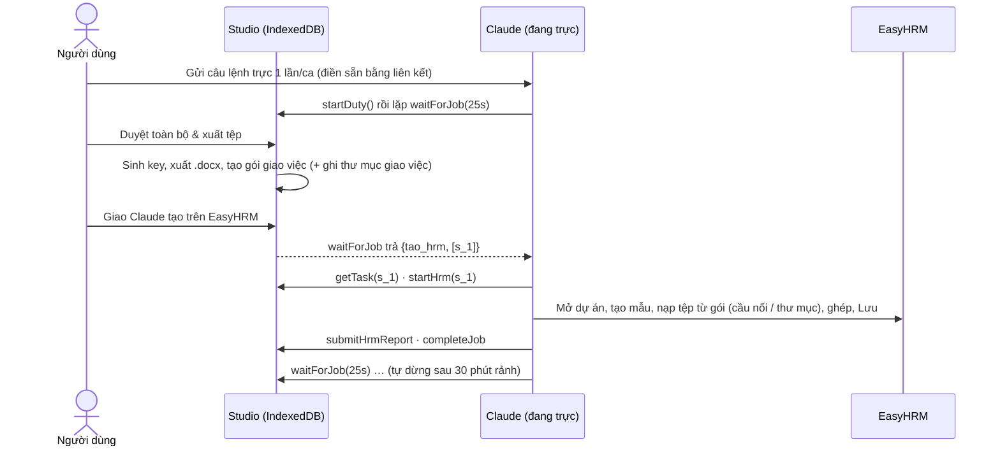

# CR-2026-003 — Tự đánh giá key thiếu trường · Duyệt toàn bộ · Giao Claude không cần dán · Kho tệp đã duyệt

| Phiên bản | Ngày | Người lập | Nội dung |
|---|---|---|---|
| 1.0.0 | 20/11/2026 | BA (ba-kit `/cr`) + BA-HRM | Lập CR từ 4 yêu cầu của người dùng sau khi chạy thử Studio v2 (skill 2.0.0) |

- **Mã CR**: `CR-2026-003` · **Người yêu cầu**: Khang (BA / triển khai EasyHRM) · **Mức khẩn**: Cao — chặn luồng "người dùng chỉ duyệt, Claude làm phần còn lại".
- **Căn cứ hành vi EasyHRM**: tri-thuc-easyhrm v2.5.39, trang `hop-dong-loai-hop-dong-mau-nguoi-ky` (mục 2 "Thêm tham số khác → Trường giá trị bổ sung", mục 4 "tham số chưa ghép trường giữ nguyên `{{…}}`"), `thiet-lap-quyet-dinh`.
- **Căn cứ Claude**: liên kết mở Claude kèm câu lệnh điền sẵn `claude://claude.ai/new?q=…` (ứng dụng desktop) và `https://claude.ai/new?q=…` (web) — Claude **chỉ điền sẵn**, người dùng xem và bấm Gửi (support.claude.com, bài 14729294).
- **Tài liệu bị thay thế một phần**: `docs/BA-v2-tu-dong-hoa.md` (G4, FR-07, FR-09, FR-11, FR-12, BR-03). Các mục khác giữ nguyên.

---

## 1. Hiện trạng và khoảng trống

| # | Yêu cầu người dùng | Hiện trạng (v2, skill 2.0.0) | Nguyên nhân gốc | Mong muốn |
|---|---|---|---|---|
| Y1 | Key không có Trường EasyHRM phải được tự đánh giá là **Trường giá trị bổ sung** hay **Tham số EasyHRM chưa có**, ghi nổi bật để người dùng để ý; không còn "— Chọn trường —" | Dòng mà quy tắc không gợi ý được và AI không đề xuất (hoặc AI gửi T4 / gap không có `label`) để trống ô trường → người dùng phải tự chọn và tự gõ tên | `buildRows` chỉ gán trường khi chữ đứng trước khớp quy tắc; `gapToExtra` bỏ qua T4 và gap thiếu nhãn; đổi Loại QĐ xoá trường mà không gán lại | Mọi dòng **luôn có kết luận** (trường danh mục / trường bổ sung / tham số chưa có / đề xuất Bỏ). Kết luận do Studio tự đánh giá được tô nổi bật kèm lý do; người dùng chỉ Duyệt |
| Y2 | Nút **Duyệt toàn bộ** cho tất cả key | Có "Duyệt các dòng đã có trường" (bỏ sót dòng trường bổ sung/thiếu) và "Duyệt toàn bộ đề xuất" ở đầu trang (dừng lại nếu còn dòng chưa có đề xuất) | Hai nút tách rời, điều kiện khác nhau | Một nút **Duyệt toàn bộ** ở thanh công cụ bảng ghép: mọi dòng chờ → Duyệt (dòng đề xuất Bỏ → Bỏ). Nút đầu trang đổi thành **Duyệt toàn bộ & xuất tệp**. Màn danh sách có duyệt hàng loạt nhiều phiên |
| Y3 | Bấm **Giao Claude** thì Claude tự nhận việc, người dùng không phải vào Claude dán lệnh | Studio chép câu lệnh vào bộ nhớ tạm, hiện "Dán vào Claude…" | Trang web tĩnh không có kênh gửi tin nhắn vào cuộc chat Claude (không dùng API key theo quyết định dự án) | **Chế độ "Claude trực"**: mở Claude một lần cho cả ca làm việc; sau đó mỗi lần bấm Giao Claude, Studio đưa việc vào hàng việc và Claude đang trực tự nhận trong ≤ 30 giây. Khi Claude chưa trực, nút mở Claude kèm câu lệnh trực **điền sẵn** (1 cú bấm Gửi, không chép/dán) |
| Y4 | Claude không tìm thấy tệp để nạp vào EasyHRM. Cần lưu tệp + dữ liệu trình duyệt lúc bấm Duyệt để AI tự lấy | Tệp xuất nằm ở `files.output` của IndexedDB trên **trình duyệt người dùng duyệt**; bị xoá khi phiên mở lại; cầu nối chỉ chạy khi Studio và EasyHRM ở cùng trình duyệt của Claude | (a) Studio của Claude mở ở trình duyệt khác (trình duyệt của Claude desktop có kho dữ liệu riêng) → `getOutputFile` báo không có tệp; (b) `reopenIfApproved` xoá `output`; (c) không có bản tệp nào trên ổ đĩa để chọn ở ô "Chọn tệp tin mẫu" | **Kho tệp đã duyệt**: mỗi lần Duyệt tạo một **gói giao việc** bất biến (tệp .docx + SHA-256 + `hrm_job`) trong IndexedDB, không bị xoá khi mở lại. **Thư mục giao việc** (tuỳ chọn, Chrome/Edge): Studio ghi gói ra thư mục trên máy ngay lúc Duyệt. Claude lấy tệp theo thứ tự: kho trong trình duyệt → thư mục giao việc → nhờ người dùng |

## 2. Phân tích tác động (Rule 15)

| Hạng mục | Mức | Thành phần bị ảnh hưởng | Khối lượng |
|---|:---:|---|:---:|
| Tài liệu | Cao | CR này; README Studio; skill `SKILL.md`, `studio-protocol.md`, `nap-tep.md`, `mapping-guide.md`; `BA-v2` (ghi chú thay thế) | 0,5 ngày |
| Dữ liệu (Dexie) | Trung bình | **v3**: bảng mới `handoffs`, `jobs`; `rows` thêm `assessedBy`; nâng cấp tự đánh giá các dòng cũ chưa có kết luận và tạo gói cho phiên đã duyệt. Không xoá dữ liệu | 0,5 ngày |
| Giao thức `tstudio/1` | Thấp (chỉ thêm) | Thêm `startDuty`, `waitForJob`, `completeJob`, `stopDuty`, `getHandoff`; `getOutputFile` đọc từ kho gói; `hrm_job.handoff` (đường dẫn trong thư mục giao việc). Skill 2.0.0 vẫn chạy (không có chế độ trực) | 1 ngày |
| Giao diện | Trung bình | Bảng ghép (bỏ ô trống, tô nổi bật, nút Duyệt toàn bộ, lọc "Studio tự đánh giá"), đầu trang phiên, danh sách phiên (chọn nhiều), thanh bên (trạng thái Claude), màn Cài vào Claude (Claude trực, Thư mục giao việc) | 1 ngày |
| Kiểm thử | Trung bình | Thêm test: tự đánh giá (nhãn, phân loại), duyệt toàn bộ, gói giao việc (bất biến khi mở lại, SHA-256), hàng việc (nhận/hoàn tất/hết hạn), nâng cấp Dexie v3. Test cũ dùng T4 chặn duyệt phải sửa | 0,5 ngày |
| Rủi ro | — | R1 Claude từ chối làm theo việc đến từ trang (an toàn) → giảm bằng BR-21; R2 chạy trực tốn lượt dùng Claude khi rảnh → BR-23 tự dừng; R3 trình duyệt không hỗ trợ ghi thư mục → thư mục là tuỳ chọn, kho IndexedDB vẫn chạy | — |

## 3. Yêu cầu chức năng

### Y1 — Tự đánh giá key không có trường

| ID | Yêu cầu | Tiêu chí chấp nhận |
|---|---|---|
| FR-31 | Studio gán **kết luận** cho mọi dòng chưa có trường danh mục, ngay khi tạo phiên, sau khi nhận đề xuất AI, sau khi đổi Loại văn bản/Loại QĐ, và khi nâng cấp dữ liệu cũ | Given phiên có chỗ "Địa điểm làm việc: ……" mà danh mục không có trường tương ứng, When tạo phiên, Then dòng có loại **Trường giá trị bổ sung**, tên "Địa điểm làm việc", key `{{DiaDiemLamViec}}`, không còn ô "— Chọn trường —" |
| FR-32 | Tên tham số tự đặt từ chữ đứng trước chỗ cần điền (bỏ dấu `:`, "ông/bà", số thứ tự, tối đa 6 từ); không có chữ dẫn → tên theo loại giá trị (Ngày…, Số tiền, Số văn bản, Họ tên, Số giấy tờ, Nội dung) kèm số thứ tự chỗ | "Mức lương chính: ……" → "Mức lương chính"; "…, ngày … tháng … năm …" ở đầu văn bản → "Ngày lập văn bản" |
| FR-33 | Phân loại theo BR-17/BR-18: **Tham số EasyHRM chưa có** (T1 dữ liệu vốn có trong hồ sơ / T3 phải tính, ghép) hoặc **Trường giá trị bổ sung** (T2 nhập mỗi lần lập văn bản). Cả hai đều có key và được Claude tạo thành "Trường giá trị bổ sung" trên EasyHRM để văn bản in không còn `{{…}}` | "Số sổ BHXH" (danh mục chưa có) → Tham số EasyHRM chưa có (T1); "Lương bằng chữ" → T3; "Lý do điều chuyển" → Trường giá trị bổ sung |
| FR-34 | Dòng do Studio tự đánh giá (chưa có ai xác nhận) được **tô nổi bật**: viền trái màu cảnh báo, nhãn "Studio đánh giá · …", lý do; thẻ thống kê "Cần bạn để ý"; nút lọc "Chỉ dòng Studio tự đánh giá" | Có 3 dòng tự đánh giá → thẻ hiện 3; bấm lọc → chỉ còn 3 dòng |
| FR-35 | Người dùng đổi kết luận bằng ô chọn (trường danh mục / Trường giá trị bổ sung / Tham số EasyHRM chưa có) và sửa tên; với Tham số chưa có chọn T1 hoặc T3. Không có lựa chọn để trống | Đổi sang "Tham số EasyHRM chưa có" → dòng chuyển T1, key giữ theo tên |
| FR-36 | AI gửi gap T4 hoặc gap thiếu `label` → Studio vẫn tự đánh giá (độ tin cậy Thấp, giữ ghi chú AI) thay vì để trống | Đề xuất `{group:"T4"}` cho c5 → c5 có kết luận, nhãn "Studio đánh giá", lý do có ghi chú AI |
| FR-37 | Mục **Tham số thiếu** chỉ liệt kê T1/T3 (cần báo đội sản phẩm EasyHRM); Trường giá trị bổ sung liệt kê riêng | — |

### Y2 — Duyệt toàn bộ

| ID | Yêu cầu | Tiêu chí chấp nhận |
|---|---|---|
| FR-38 | Nút **Duyệt toàn bộ** trên thanh công cụ bảng ghép: mọi dòng **Chờ** → Duyệt; dòng có "Đề xuất Bỏ" → Bỏ. Dòng người dùng đã quyết không đổi | 10 dòng chờ (1 đề xuất Bỏ) → 9 Duyệt, 1 Bỏ, thông báo "9 duyệt, 1 bỏ" |
| FR-39 | Nút đầu trang **Duyệt toàn bộ & xuất tệp**: FR-38 rồi Duyệt phiên (sinh key, xuất .docx, kiểm lỗi, tạo gói giao việc FR-45) | Phiên hợp lệ → trạng thái Đã duyệt sau 1 cú bấm |
| FR-40 | Màn **Phiên làm việc**: chọn nhiều phiên (Nháp / Chờ AI / Chờ duyệt) → **Duyệt toàn bộ & xuất tệp** từng phiên; tuỳ chọn **giao luôn cho Claude tạo trên EasyHRM**. Phiên lỗi báo riêng, phiên khác vẫn chạy | Chọn 3 phiên, 1 phiên có cảnh báo dữ liệu cá nhân → 2 Đã duyệt, 1 báo "cần mở phiên kiểm tra cảnh báo" |

### Y3 — Giao Claude không cần dán (chế độ Claude trực)

| ID | Yêu cầu | Tiêu chí chấp nhận |
|---|---|---|
| FR-41 | Hàng việc `jobs`: bấm **Giao Claude phân tích** / **Giao Claude tạo trên EasyHRM** luôn tạo một việc `{loại, danh sách phiên}` ở trạng thái Chờ | Bấm Giao Claude tạo cho s_1 → có job `tao_hrm` [s_1] trạng thái Chờ |
| FR-42 | Claude trực gọi `startDuty` rồi lặp `waitForJob(≤25 giây)`; việc Chờ cũ nhất được trả về và chuyển Đang làm; xong gọi `completeJob`. Mỗi lần gọi ghi **nhịp trực** | Có job Chờ → `waitForJob` trả job trong ≤ 2 giây; không có → trả `null` khi hết thời gian chờ |
| FR-43 | Thanh bên hiển thị **Claude đang trực** (nhịp ≤ 60 giây, hết hạn trực chưa qua) hoặc **Claude chưa trực**. Khi đang trực, bấm Giao Claude chỉ hiện "Claude đã nhận việc", không chép, không mở gì | — |
| FR-44 | Khi Claude chưa trực, bấm Giao Claude: tạo job (FR-41) **và** mở Claude bằng liên kết điền sẵn **câu lệnh trực** (theo cài đặt: Ứng dụng Claude desktop `claude://` / claude.ai web / chỉ chép). Người dùng chỉ bấm Gửi một lần cho cả ca | Cài đặt "Ứng dụng desktop" → mở `claude://claude.ai/new?q=<câu lệnh trực>` |

### Y4 — Kho tệp đã duyệt và thư mục giao việc

| ID | Yêu cầu | Tiêu chí chấp nhận |
|---|---|---|
| FR-45 | Duyệt phiên thành công → tạo **gói giao việc** bất biến `handoffs` (tệp, tên, kích thước, SHA-256, `hrm_job`, phiên bản n). Mở lại phiên → gói cũ đánh dấu "đã thay", **không xoá**; duyệt lại → gói phiên bản n+1 | Duyệt → mở lại → duyệt: có 2 gói, gói 2 đang dùng |
| FR-46 | `getOutputFile`, trang cầu nối và `hrm_job.file` lấy từ gói đang dùng; `getHandoff(id)` trả thông tin gói và đường dẫn trong thư mục giao việc | Phiên Đã duyệt → `getOutputFile` trả đúng kích thước và SHA-256 của gói |
| FR-47 | **Thư mục giao việc** (Chrome/Edge): người dùng chọn một lần ở màn Cài vào Claude. Mỗi lần Duyệt, Studio ghi `EasyHRM-Studio/<dự án>/<thứ tự>-<mã phiên>/<tên tệp>_TenKey.docx` và `job.json`, cập nhật `EasyHRM-Studio/hang-doi.json`. Ghi lỗi không chặn Duyệt (cảnh báo) | Đã chọn thư mục → Duyệt → tệp .docx có trên ổ đĩa, `job.json` có `sha256` khớp |
| FR-48 | Skill lấy tệp theo thứ tự: (A) cầu nối từ kho gói trong cùng trình duyệt; (B) đọc theo đoạn `getOutputFile`; (C) Studio của Claude không có phiên (khác trình duyệt) → đọc thư mục giao việc qua quyền truy cập thư mục của Claude desktop, kiểm SHA-256, nạp vào ô "Chọn tệp tin mẫu"; (D) nhờ người dùng chọn tệp — đường dẫn tệp đã có sẵn trên máy | — |

## 4. Quy tắc nghiệp vụ

| ID | Quy tắc | Nguồn |
|---|---|---|
| BR-17 | Kết luận của một dòng chỉ là một trong: Trường danh mục · Trường giá trị bổ sung (T2) · Tham số EasyHRM chưa có (T1/T3) · Đề xuất Bỏ. Không có trạng thái "chưa chọn trường" | Yêu cầu Y1 |
| BR-18 | Phân loại Tham số chưa có: tên chứa từ chỉ dữ liệu hồ sơ (dân tộc, tôn giáo, trình độ, chuyên môn, bằng cấp, học hàm, học vị, sổ BHXH, mã số thuế, tài khoản ngân hàng, hệ số, bậc, ngạch, giới tính, nơi sinh, quê quán, thường trú, chỗ ở, điện thoại, email, ngày vào, CCCD/CMND, ngày cấp, nơi cấp, quốc tịch, mã nhân viên, phụ cấp…) → T1; chứa "bằng chữ", "tổng", "cộng", "thành tiền", "số năm/tháng công tác" → T3; chữ dẫn khớp quy tắc gợi ý trường (`suggest.ts`) nhưng danh mục thiếu trường → T1; còn lại → T2 | tri-thuc: nhóm trường Nhân viên/Hợp đồng/Lương; BA-v2 BR-14 |
| BR-19 | T1/T3 vẫn được tạo "Trường giá trị bổ sung" trên EasyHRM (tham số chưa ghép trường in ra nguyên `{{…}}`), đồng thời liệt kê ở "Tham số thiếu" để đề nghị đội sản phẩm bổ sung trường | tri-thuc `hop-dong-loai-hop-dong-mau-nguoi-ky` mục 4 |
| BR-20 | Dòng tự đánh giá (`assessedBy = studio`) chỉ hết nổi bật khi người dùng Duyệt/Bỏ hoặc đổi kết luận; AI đề xuất lại thì `assessedBy = ai` | Y1 |
| BR-21 | Sự đồng ý **tạo mẫu và bấm Lưu** nằm trong **câu lệnh trực** người dùng gửi trong chat, có thời hạn (mặc định 4 giờ, tối đa 8 giờ). Việc trong hàng việc chỉ mang **loại + mã phiên**, không mang lệnh; Claude luôn kiểm lại `getTask` (Đã duyệt + đã giao). Câu lệnh trực không có câu đồng ý Lưu → Claude làm tới trước nút Lưu thì hỏi | Thay BA-v2 BR-03 |
| BR-22 | Hàng việc và kho gói nằm trong IndexedDB **của trình duyệt mở Studio**. Chế độ trực cần Studio mở trong **cùng trình duyệt Claude điều khiển** (Claude in Chrome = Chrome của người dùng; hoặc mở Studio trong trình duyệt của Claude desktop) | Giới hạn kỹ thuật |
| BR-23 | Claude tự dừng trực khi hết hạn trực hoặc 30 phút liên tục không có việc, gọi `stopDuty`, báo người dùng một dòng | Kiểm soát chi phí |
| BR-24 | Việc Đang làm quá 30 phút không có nhịp trực → trở lại Chờ (Claude mất kết nối giữa chừng); phiên đang `dang_tao` giữ nguyên để Claude kiểm danh sách EasyHRM trước khi Lưu lại (BA-v2 BR-07) | — |
| BR-25 | Gói giao việc không bao giờ bị sửa; xoá phiên mới xoá gói. Thư mục giao việc chứa dữ liệu thật của mẫu (không có dữ liệu nhân viên sau khi duyệt) — người dùng tự quản lý | — |
| BR-26 | Studio vẫn **không lưu mật khẩu**, Claude không gõ mật khẩu (BA-v2 BR-01 giữ nguyên) | BA-v2 |

## 5. Ma trận lỗi

| Mã | Tình huống | Thông báo (tiếng Việt) | Xử lý |
|---|---|---|---|
| ERR-31 | Ghi thư mục giao việc bị từ chối quyền | "Chưa ghi được ra thư mục giao việc — bấm Cấp lại quyền ở Cài vào Claude. Phiên vẫn đã duyệt." | Không chặn Duyệt |
| ERR-32 | Trình duyệt không hỗ trợ ghi thư mục | "Trình duyệt này không ghi được thư mục (cần Chrome hoặc Edge). Kho tệp trong trình duyệt vẫn dùng được." | Ẩn chọn thư mục |
| ERR-33 | `waitForJob` khi chưa `startDuty` | "Chưa bắt đầu trực — gọi startDuty trước." | Trả `ok:false` |
| ERR-34 | `completeJob` sai mã / việc không Đang làm | "Việc … không ở trạng thái Đang làm." | Trả `ok:false` |
| ERR-35 | `getOutputFile` khi chưa có gói | "Phiên chưa có gói giao việc — người dùng cần Duyệt phiên." | Trả `ok:false` |
| ERR-36 | Duyệt hàng loạt gặp phiên có cảnh báo dữ liệu cá nhân | "<tệp>: còn cảnh báo dữ liệu cá nhân — mở phiên để xác nhận." | Bỏ qua phiên đó |

## 6. Dữ liệu — Dexie v3 (chỉ thêm)

| Bảng | Khoá / chỉ mục | Trường |
|---|---|---|
| `handoffs` (mới) | `id` = `<sessionId>#<n>`; chỉ mục `sessionId`, `[sessionId+active]` | `sessionId, projectId, version, active (0/1), fileName, blob, size, sha256, job (HrmJob), approvedAt, mirroredPath?, mirroredAt?` |
| `jobs` (mới) | `id`; chỉ mục `status`, `createdAt` | `kind ('phan_tich' \| 'tao_hrm'), sessionIds[], status ('cho' \| 'dang_lam' \| 'xong' \| 'huy'), createdAt, takenAt?, doneAt?, note?` |
| `rows` | — | thêm `assessedBy?: 'studio' \| 'ai'` |
| `settings` | — | `claudeDuty {startedAt, until, heartbeatAt, skillVersion, consentSave}`, `handoffDir` (FileSystemDirectoryHandle), `claudeOpenMode` |

Nâng cấp v3: (1) mọi dòng chưa có trường/kết luận → tự đánh giá theo FR-31…33 dựa trên `context`; (2) phiên Đã duyệt / Đang tạo / Dừng có `files.output` → tạo gói phiên bản 1. Sao lưu/khôi phục bao gồm `handoffs` (base64) và `jobs`.

## 7. Luồng mới

## 8. Câu hỏi mở / giới hạn đã biết
1. Không có cách hợp lệ để trang web **tự gửi** tin nhắn vào cuộc chat Claude mà không có API key; liên kết `?q=` của Claude cố ý chỉ điền sẵn. Vì vậy mức tối thiểu là **1 lần bấm Gửi cho mỗi ca làm việc**, sau đó mọi lần Giao Claude không cần thao tác trong Claude.
2. Chế độ trực tốn lượt dùng Claude trong lúc chờ (mỗi 25 giây một lần gọi). Mặc định thời hạn 4 giờ, tự dừng sau 30 phút rảnh — điều chỉnh theo thực tế.
3. Nếu người dùng duyệt ở Chrome còn Claude dùng trình duyệt riêng của Claude desktop: chế độ trực không thấy việc (BR-22). Khi đó dùng Claude in Chrome, hoặc mở Studio ngay trong trình duyệt của Claude desktop.
